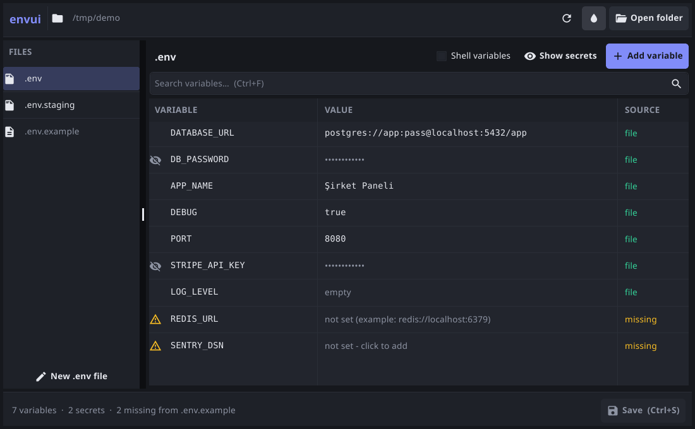
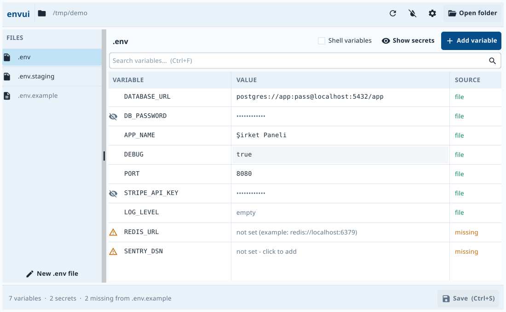

<p align="center"></p>

# envui

[Türkçe](README.md) | **English**

A visual .env file editor built with Go and Fyne.


## Why?

Managing .env files is a pain:

- Which variables are missing compared to `.env.example`?
- Which ones are set in the file, and which come from the shell?
- Did I accidentally commit a secret?
- What's different between local and staging?

envui lets you view and edit environment variables across multiple .env files from a single window.

| Dark theme | Light theme |
| --- | --- |
|  |  |

## Features

- **Visual editor**: All variables are listed in a table. Click a row to edit it.
- **Secret masking**: Sensitive values such as API_KEY, PASSWORD and TOKEN are detected and masked automatically.
- **Multi-file support**: Switch between `.env`, `.env.local`, `.env.staging` and similar files.
- **Missing variables**: Keys in `.env.example` that aren't set in your file are highlighted. Click one to add it with the example value.
- **Source tracking**: See whether a variable comes from the file or the shell environment.
- **Search**: Filter variables by name or value.
- **Light and dark themes**: Matching the GLARK brand colours. Your choice is remembered between runs.
- **Languages**: Turkish and English. Picked from your system language and changeable in Settings.
- **Remembers folders**: The folder picker opens next to the project you opened last.
- **File comparison**: See two files (e.g. `.env` and `.env.staging`) side by side. Different, missing and extra variables are colour-coded; click a row to copy the value to the other file.
- **Problem checks**: Flags keys defined twice, values with leading/trailing spaces, and values that are empty although `.env.example` has one.
- **Git warning**: Warns when your `.env` files aren't ignored by git and adds them to `.gitignore` in one click.
- **Undo / redo**: Every edit can be undone with Ctrl+Z and redone with Ctrl+Y.
- **Copy to other files**: Add a variable to several files at once.
- **Recent projects and drag & drop**: Reopen recent projects, or drop a folder onto the window.
- **Update notice**: Tells you in the status bar when a new version is out (can be turned off in Settings).
- **Descriptions and sections**: The `#` lines above a variable appear in a "Description" column and can be edited in the variable editor. `# ==== / # Title / # ====` blocks become section headings in the table. Search also looks in descriptions.
- **Comments and formatting preserved**: Comments, `export` lines, quotes and every line you didn't touch stay exactly as they were.

### Keyboard shortcuts

| Shortcut | Action |
| --- | --- |
| `Ctrl+S` | Save all changed files |
| `Ctrl+N` | Add a variable |
| `Ctrl+F` | Search |
| `Ctrl+O` | Open a folder |
| `Ctrl+Z` / `Ctrl+Y` | Undo / redo |
| `Ctrl+D` | Compare files |
| `F1` | About dialog |

Use `Cmd` instead of `Ctrl` on macOS.

## Installation

### Download (Windows)

Pick one from the [Releases](https://github.com/lazymule/envui/releases) page:

| File | When? |
| --- | --- |
| `envui-setup.exe` | **Recommended.** Installer with Start menu shortcut and uninstall support. |
| `envui-portable.zip` | **Portable** edition: no installation, settings are kept in `envui-portable.json` next to the program. Great for USB sticks. |
| `envui-windows-amd64.exe` | Just the program file (no virtual machine support). |

The installer and the portable edition also work in virtual machines and Remote Desktop without any extra steps (see [Troubleshooting](#troubleshooting)).

### From source

```bash
git clone https://github.com/lazymule/envui.git
cd envui
go build -o envui .
```

### Requirements

- Go 1.23 or later
- A C compiler (Fyne uses cgo)
- On Linux you may also need: `libgl1-mesa-dev xorg-dev`

### Building for Windows

To build natively on Windows, you need a C compiler on the PATH (such as [TDM-GCC](https://jmeubank.github.io/tdm-gcc/) or MSYS2):

```bash
go build -ldflags "-H=windowsgui" -o envui.exe .
```

To cross-compile from Linux, you need `gcc-mingw-w64-x86-64`:

```bash
CGO_ENABLED=1 GOOS=windows GOARCH=amd64 CC=x86_64-w64-mingw32-gcc \
  go build -ldflags "-H=windowsgui -s -w" -o envui.exe .
```

## Usage

Open the app and pick a folder:

```bash
./envui
```

Or open a project folder directly:

```bash
./envui ~/Projects/my-app
```

On Windows, just double-click `envui.exe`.

## Troubleshooting

### "WGL: The driver does not appear to support OpenGL"

envui draws its window with OpenGL 2.1. Virtual machines (VirtualBox, Hyper-V, VMware), Remote Desktop (RDP) sessions and computers without a graphics driver may not provide it.

**Fix:** use the installer (`envui-setup.exe`) or the portable edition (`envui-portable.zip`). Both contain a `softgl` folder with a copy of envui.exe and Mesa's software OpenGL renderer (`opengl32.dll`, `libgallium_wgl.dll`). At start, envui quickly probes the computer's OpenGL support; if it isn't good enough, envui restarts itself from `softgl` and renders with the CPU. Computers with a graphics card keep the normal (fast) path, and other programs are not affected. The "Graphics" row in the About dialog shows which path is in use.

Set the `ENVUI_SOFTWARE_GL=1` environment variable to force software rendering.

If you connect over RDP to a computer that has a graphics card, enabling this Group Policy on the remote computer also helps: *Remote Desktop Session Host → Remote Session Environment → "Use hardware graphics adapters for all Remote Desktop Services sessions"*.

## Settings

Open Settings with the ⚙ icon in the header:

- **Language**: Türkçe or English. The interface updates immediately, and the open project and unsaved changes are kept.
- **Theme**: Light or Dark.
- **On start**: Whether shell variables and secret values are shown on start, and whether to check for updates.

The update check reads the latest release information from GitHub at most once a day; nothing else is sent.

The folder picker is a built-in Fyne component, so it is always shown in English.

## Supported files

envui automatically discovers these files:

- `.env`
- `.env.local`
- `.env.development`
- `.env.staging`
- `.env.production`
- `.env.prod`
- `.env.example`
- `.env.sample`
- `.env.template`
- `.env.test`

`.env.example`, `.env.sample` and `.env.template` are treated as templates. Missing variables are worked out from them.

## Documented files

envui reads the descriptions in your `.env` file:

```bash
# ============================================================================
# Database (SQL Server login)               ← section heading
# ============================================================================
# Upper limit for lock waits (ms)           ← description of db.lock_timeout_ms
db.lock_timeout_ms=15000
# User and password are required            ← description of db.username;
db.username=                                  also shown (dimmed) for the
db.password=                                  db.password right below it
logger.level=debug # debug, info, warning   ← trailing comment
```

If you change a description in the editor it is written back as `#` lines. Deleting a variable also deletes its description lines. Section headings and other comments stay as they are.

### How values are written

Values you edit are written so that `.env` loaders (DelphiMVCFramework, Docker Compose, python-dotenv…) read them back unchanged:

| Value | Written as |
| --- | --- |
| `logs\analytics` | `logs\analytics` (backslashes are kept as they are) |
| `p#ro$x` | `'p#ro$x'` (single quotes when it has `#`, `$`, `"` or `\`) |
| `hello world` | `"hello world"` |

## Secret detection

Variables whose names contain these patterns are masked automatically:

- `PASSWORD`, `PASSWD`, `SECRET`, `TOKEN`, `AUTH`, `CREDENTIAL`, `DSN`
- `API_KEY`, `APIKEY`, `PRIVATE_KEY`, `ACCESS_KEY`
- Turkish: `SIFRE` / `ŞİFRE`, `PAROLA`, `ANAHTAR`
- A name part that is exactly `KEY`, `PWD` or `PASS` (e.g. `WEB_SERVICE_KEY`, `db.pwd`)

Names that describe a length, duration or limit are not masked (e.g. `guvenlik.min_parola_uzunlugu`, `TOKEN_EXPIRE_MINUTES`).

## Development

```bash
# Run
go run .

# Build
go build -o envui .

# Run tests
go test ./...
```

To regenerate the icon, run `python3 tools/make_icon.py`, then refresh the Windows resource:

```bash
x86_64-w64-mingw32-windres -O coff -i winres/envui.rc -o rsrc_windows_amd64.syso
```

To build every Windows package (exe, installer, portable zip; needs `go`, `x86_64-w64-mingw32-gcc`, `7z`, `zip`, `makensis`):

```bash
tools/package_windows.sh
```

To add a language, add a section to the `messages` table in `ui/i18n.go` and an entry to the `languages` list. The tests flag any missing translations.

## Contributing

See [CONTRIBUTING.md](CONTRIBUTING.md) for guidelines.

## Acknowledgements

This project is a fork of [mrf/envui](https://github.com/mrf/envui) by **Mark Ferree**. The `.env` parser, the comment-preserving writer and the original interface are his work. Many thanks to him for sharing the project as open source. 🙏

This fork adds a refreshed interface, Turkish language support, a Settings dialog and many smaller improvements. See [CHANGELOG.md](CHANGELOG.md) for details.

## License

MIT License. See [LICENSE](LICENSE) for details.
