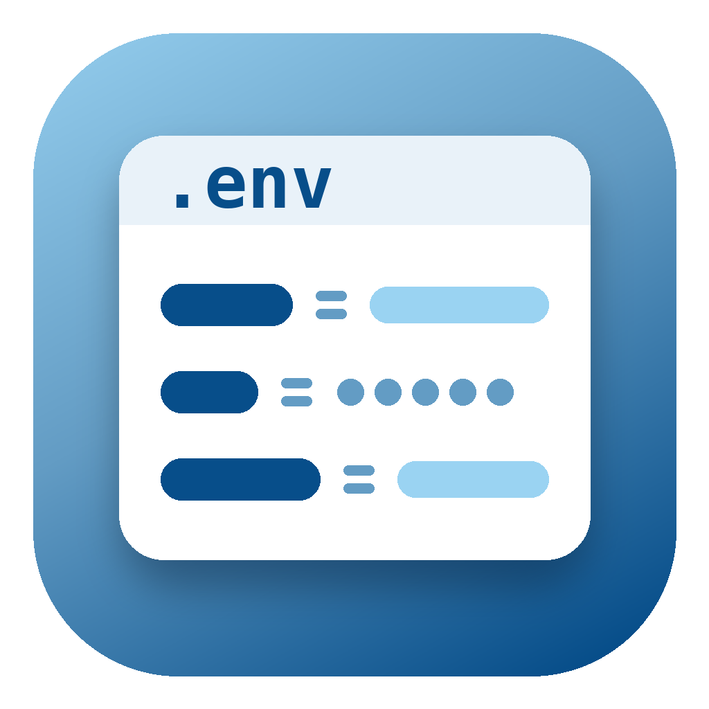
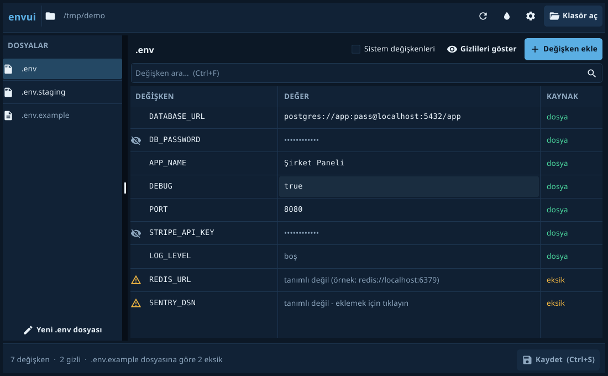
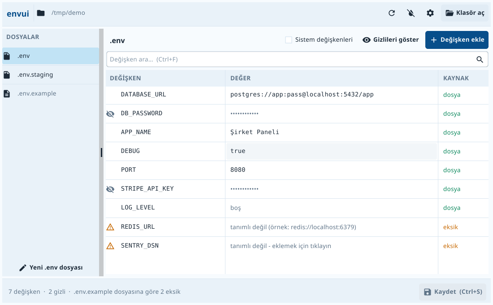

<p align="center"></p>

# envui

**Türkçe** | [English](README.en.md)

Go ve Fyne ile yazılmış, `.env` dosyaları için görsel bir düzenleyici.


## Neden?

`.env` dosyalarını yönetmek can sıkıcı:

- `.env.example` dosyasına göre hangi değişkenler eksik?
- Hangisi dosyada tanımlı, hangisi sistemden geliyor?
- Yanlışlıkla bir şifreyi commit ettim mi?
- Yerel ortam ile staging arasında ne fark var?

envui, birden fazla `.env` dosyasındaki ortam değişkenlerini tek bir pencereden görüp düzenlemenizi sağlar.

| Koyu tema | Açık tema |
| --- | --- |
|  |  |

## Özellikler

- **Görsel düzenleyici**: Tüm değişkenler tabloda listelenir, düzenlemek için satıra tıklamanız yeterli.
- **Gizli değer maskeleme**: API_KEY, PASSWORD, TOKEN gibi hassas değerler otomatik algılanır ve gizlenir.
- **Çoklu dosya desteği**: `.env`, `.env.local`, `.env.staging` gibi dosyalar arasında geçiş yapabilirsiniz.
- **Eksik değişkenler**: `.env.example` dosyasında olup sizin dosyanızda olmayan değişkenler işaretlenir. Tıklayarak örnek değerle ekleyebilirsiniz.
- **Kaynak takibi**: Değişkenin dosyadan mı yoksa sistemden mi geldiği görünür.
- **Arama**: Değişkenleri ada veya değere göre filtreleyebilirsiniz.
- **Açık ve koyu tema**: GLARK kurumsal renkleriyle uyumludur. Seçiminiz bir sonraki açılışta da geçerli olur.
- **Dil desteği**: Türkçe ve İngilizce. Sistem diline göre otomatik seçilir, Ayarlar'dan değiştirilebilir.
- **Klasör hatırlama**: Klasör seçme penceresi en son açtığınız projenin yanından başlar.
- **Yorumlar korunur**: Kaydederken dosyadaki yorum satırlarınız silinmez.

### Klavye kısayolları

| Kısayol | İşlev |
| --- | --- |
| `Ctrl+S` | Değişen tüm dosyaları kaydet |
| `Ctrl+N` | Değişken ekle |
| `Ctrl+F` | Ara |
| `Ctrl+O` | Klasör aç |

macOS'ta `Ctrl` yerine `Cmd` kullanılır.

## Kurulum

### Kaynaktan derleme

```bash
git clone https://github.com/lazymule/envui.git
cd envui
go build -o envui .
```

### Gereksinimler

- Go 1.23 veya üstü
- Bir C derleyicisi (Fyne, cgo kullanır)
- Linux'ta ek olarak şu paketler gerekebilir: `libgl1-mesa-dev xorg-dev`

### Windows için derleme

Windows'ta doğrudan derlemek için PATH'te bir C derleyicisi olmalı ([TDM-GCC](https://jmeubank.github.io/tdm-gcc/) veya MSYS2 gibi):

```bash
go build -ldflags "-H=windowsgui" -o envui.exe .
```

Linux'tan Windows için derlemek isterseniz `gcc-mingw-w64-x86-64` paketi gerekir:

```bash
CGO_ENABLED=1 GOOS=windows GOARCH=amd64 CC=x86_64-w64-mingw32-gcc \
  go build -ldflags "-H=windowsgui -s -w" -o envui.exe .
```

## Kullanım

Programı açıp bir klasör seçin:

```bash
./envui
```

Ya da bir proje klasörünü doğrudan açın:

```bash
./envui ~/Projeler/uygulamam
```

Windows'ta `envui.exe` dosyasına çift tıklamanız yeterli.

## Ayarlar

Başlıktaki ⚙ simgesiyle açılır:

- **Dil**: Türkçe veya English. Arayüz anında yenilenir, açık proje ve kaydedilmemiş değişiklikler kaybolmaz.
- **Tema**: Açık veya Koyu.
- **Açılışta**: Sistem değişkenlerinin ve gizli değerlerin gösterilip gösterilmeyeceği.

Klasör seçme penceresi Fyne'ın kendi bileşeni olduğu için her zaman İngilizce görünür.

## Desteklenen dosyalar

envui şu dosyaları otomatik olarak bulur:

- `.env`
- `.env.local`
- `.env.development`
- `.env.staging`
- `.env.production`
- `.env.prod`
- `.env.example`
- `.env.sample`
- `.env.template`
- `.env.test`

`.env.example`, `.env.sample` ve `.env.template` şablon dosyası olarak kabul edilir. Eksik değişkenler bunlara göre belirlenir.

## Gizli değer algılama

Adında şu ifadeler geçen değişkenler otomatik olarak maskelenir:

- `PASSWORD`, `SECRET`, `TOKEN`
- `API_KEY`, `APIKEY`, `API_SECRET`
- `PRIVATE_KEY`, `ACCESS_KEY`
- `AUTH`, `CREDENTIAL`, `DSN`

## Geliştirme

```bash
# Çalıştır
go run .

# Derle
go build -o envui .

# Testleri çalıştır
go test ./...
```

Simgeyi yeniden üretmek için `python3 tools/make_icon.py` komutunu çalıştırın. Ardından Windows kaynağını güncelleyin:

```bash
x86_64-w64-mingw32-windres -O coff -i winres/envui.rc -o rsrc_windows_amd64.syso
```

Yeni bir dil eklemek için `ui/i18n.go` dosyasındaki `messages` tablosuna bir bölüm ve `languages` listesine bir satır eklemeniz yeterli. Testler, eksik çeviri kaldıysa uyarır.

## Katkıda bulunma

Kurallar için [CONTRIBUTING.md](CONTRIBUTING.md) dosyasına bakın.

## Teşekkürler

Bu proje, **Mark Ferree**'nin [mrf/envui](https://github.com/mrf/envui) projesinden çatallanmıştır. Temeli oluşturan `.env` ayrıştırıcısı, yorum koruyan yazıcı ve ilk arayüz onun emeğidir. Projeyi açık kaynak olarak paylaştığı için kendisine çok teşekkür ederiz. 🙏

Bu çatalda arayüz yenilendi, Türkçe dil desteği, Ayarlar penceresi ve birçok küçük iyileştirme eklendi. Ayrıntılar için [CHANGELOG.md](CHANGELOG.md) dosyasına bakabilirsiniz.

## Lisans

MIT Lisansı. Ayrıntılar için [LICENSE](LICENSE) dosyasına bakın.
